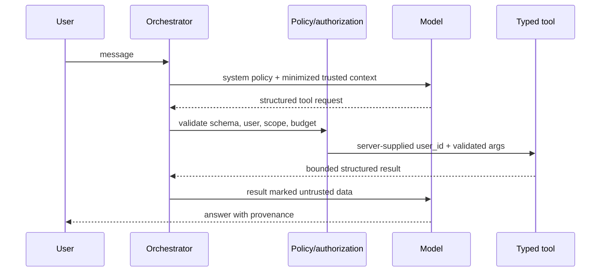

# AI architecture and safety

## Shared AI platform

Domain modules call an internal `ModelGateway`, never vendor SDKs directly. Requests identify `operation`, provider/model policy, prompt template/version, JSON Schema, timeout, token/cost budget, and trace ID. The gateway applies redaction/minimization, deterministic settings where useful, retries only safe failures, schema validation, usage/cost records, and fallback policy. Providers are configurable and no real inference occurs without credentials and explicit enablement.

Prompts are versioned files reviewed like code. Contract tests replay sanitized fixtures against mocked provider responses; optional live evals are separate and budget-gated. Inputs/outputs are not logged by default and are not used for provider training where provider controls allow opt-out.

## CV understanding

Deterministic extraction precedes AI: file signature/type checks → PDF/DOCX text/layout extraction → scan/image detection → isolated OCR when justified. Extracted spans have page/offset provenance. The structured parser returns nullable fields with evidence spans/confidence; a verifier rejects unsupported claims. User corrections create revisions and outrank machine output. Analysis reads the corrected snapshot and produces only rubric findings/suggestions, never new factual qualifications.

## Matching

First parse job requirements into typed required/optional constraints with source quotes. Deterministic rules compute hard filters and evidence coverage. Embeddings may later improve semantic recall but cannot override hard constraints or serve as the sole explanation. An LLM may phrase an explanation from precomputed evidence; schema validation requires separate `matches`, `gaps`, and `unknowns`. Store scorer/prompt/model versions for reproducibility.

## Assistant tool execution

Allowed tools are narrow services such as `get_current_cv_profile`, `get_cv_analysis`, `search_jobs`, `compare_job`, `get_interview_history`, and `start_interview`. The model cannot supply `user_id`, execute SQL, read object keys, access arbitrary URLs, or call a shell. Tool counts, payload sizes, and nesting are capped; sensitive/high-impact actions require user confirmation.

Uploaded text, listings, and messages are wrapped as untrusted data with instructions stripped from authority. Defense is structural: fixed system policy, data/control separation, tool allow-list, server-side authorization, egress allow-list, argument/result schemas, URL safety, least privilege, and output encoding—not merely a “ignore prompt injection” sentence.

## Interviews

An interview policy engine persists the selected CV snapshot, job snapshot, mode, difficulty, asked topics, and conversation state. Each turn selects a competency gap, asks exactly one question, and may request a contextual follow-up based on the answer. A deterministic controller enforces limits, skips, non-repetition, relevance, and end state. Evaluation is a separate pass using explicit technical accuracy, evidence/depth, clarity/structure, and role relevance rubrics. It cites response excerpts, distinguishes uncertainty, avoids personality/mental-state claims, and labels example answers as coaching suggestions.

## Evaluation and operations

Quality gates cover unsupported-claim rate, extraction field precision/recall, schema compliance, injection/tool-escape resistance, match NDCG plus explanation faithfulness, interview repetition/relevance, latency, and per-operation cost. Model/prompt changes run a regression suite and support rollback. Human feedback is consented, access-controlled, and separated from production PII.
