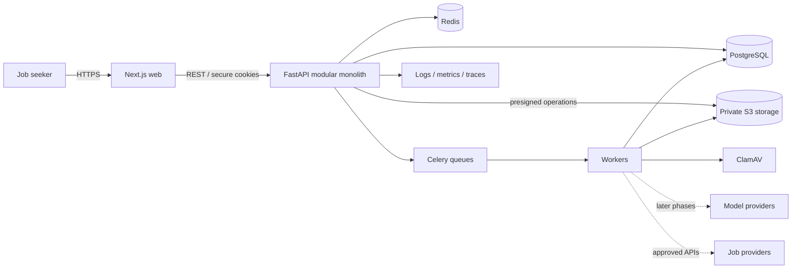
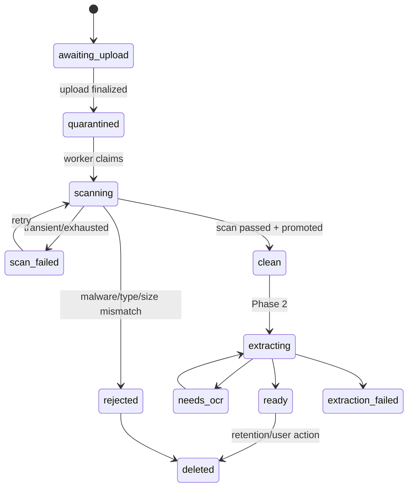

# System architecture and responsibilities

## Context and containers



The browser uploads documents directly to a short-lived, size-constrained quarantine URL. The API owns authorization and lifecycle state. Workers scan before promoting objects to the private clean bucket. Neither web nor model provider receives raw storage credentials.

## Modular monolith

| Module | Responsibility | Forbidden coupling |
|---|---|---|
| Identity | users, password credentials, verification, rotating sessions | No document/job internals |
| Profiles | career preferences, locale, retention choices | No protected-trait inference |
| Documents | CV metadata, versions, upload finalization, object access policy | No parsing or model calls in request path |
| Processing | state machines, scan/extraction/OCR tasks, retries/idempotency | No UI-specific formatting |
| CV intelligence | normalized facts, provenance/confidence, revisions, rubric analyses | No invented facts |
| Job intelligence | provider adapters, normalization, dedupe, expiry, matching evidence | No scraping outside approved contracts |
| Interviews | session/question/response/evaluation state | No employer selection use |
| Assistant | intent orchestration and allow-listed typed tools | No arbitrary SQL/network/filesystem |
| AI platform | provider interface, prompt registry, schema validation, budgets/usage | No domain authorization decisions |
| Audit/observability | security events, correlation IDs, metrics/traces | No secrets or CV bodies in telemetry |

Modules expose service interfaces and schemas. They share one database initially but own their tables; cross-module writes go through services. Split a service only when independent scaling, failure isolation, or regulatory boundaries justify the operational cost.

## Processing state machine



Transitions use compare-and-set status conditions. A task idempotency key is `(document_version_id, operation, processor_version)`. Every transition emits an audit event and safe user-facing status.

## Deployment

Local Compose mirrors the production roles, using Adobe S3Mock for its hermetic S3 boundary. AWS target: CloudFront/WAF → ALB → ECS/Fargate web/API/workers; RDS PostgreSQL Multi-AZ; ElastiCache Redis; private encrypted S3 with separate quarantine/clean buckets; GuardDuty/Macie where appropriate; Secrets Manager/KMS; SES for verification; ECR/CodeDeploy; OpenTelemetry collector to managed metrics/logs. Network egress from workers is allow-listed by provider class.

## Repository

```text
apps/
  api/       FastAPI app, domain modules, workers, migrations, tests
  web/       Next.js application and component system
packages/
  contracts/ generated/shared OpenAPI-derived TypeScript types
docs/        product, architecture, security, ADRs, progress
infra/       deployment-facing configuration
scripts/     repeatable developer/CI tasks
.github/     CI workflows
```
